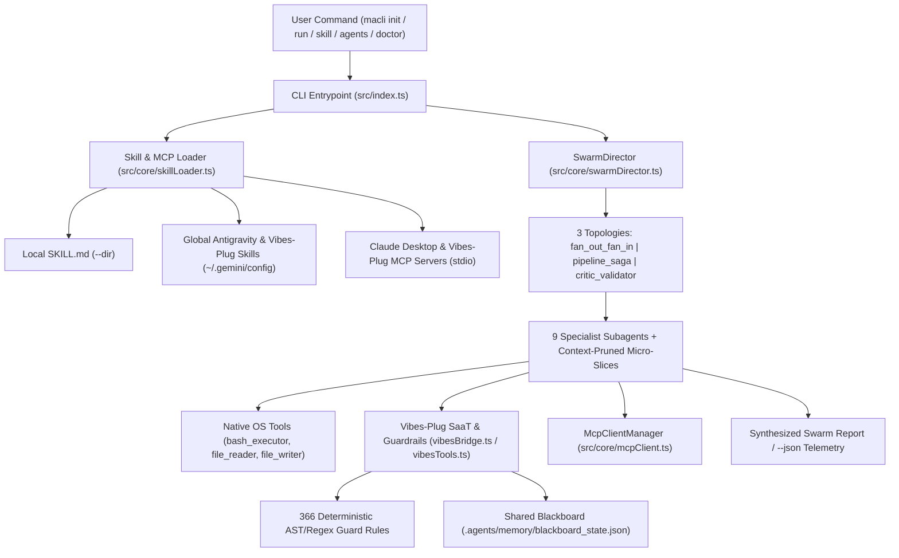

<div align="center">

# Macli v2.0.0 — Enterprise AI Agent Swarm Orchestrator

[](https://github.com/roedyrustam/macli/actions/workflows/build.yml)
[](https://www.npmjs.com/package/@roedyrustam/macli)
[](https://www.npmjs.com/package/@roedyrustam/macli)
[](https://nodejs.org/)
[](https://www.typescriptlang.org/)
[](https://modelcontextprotocol.io/)
[](./LICENSE)

**Macli** is a TypeScript CLI and multi-agent swarm orchestrator built on **LangGraph**, **Adaptive Model Cascading (Google Gemini & Anthropic Claude)**, **Model Context Protocol (MCP)**, and deep native integration with **`vibes-plug` v4.8.0**.

[Installation](#installation) • [Initialization](#initialization) • [CLI Usage](#cli-usage) • [Architecture](#architecture--development) • [Community](#community-security--contributing)

</div>

---

## Core Capabilities (v2.0.0)

- **9 Native Specialist Subagents**: Orchestrates `swarm-architect`, `fullstack-craftsman`, `quality-guardian`, `data-rag-architect`, `fintech-payment-sentinel`, `cloud-devops-sre`, `ai-mcp-engineer`, `mobile-spatial-craftsman`, and `reverse-security-auditor`.
- **3 Swarm Execution Topologies**:
  - `fan_out_fan_in`: Parallel specialist execution with shared Blackboard synthesis.
  - `pipeline_saga`: Sequential staged execution forwarding prior stage artifacts.
  - `critic_validator`: Implementer execution gated by `quality-guardian` deterministic verification.
- **178 Guarded Skills & Pre-Compiled Micro-Slices**: Parses YAML frontmatter, orchestration graph links, and `<350`-token micro-slices from `vibes-plug/.skill-slices.json` (`1,199` code blueprints).
- **Universal Skill-as-a-Tool (SaaT) Dispatcher**: Deterministic execution of skill actions (`audit`, `eval`, `verify`, `generate`, `fuzz`, `optimize`, `slice`, `blueprint`, `extract-code`, `rules`, `health`, `budget`) and Autonomous Skill Composition Chains (`saas-launch-gate`, `ai-agent-hardening`, `fintech-settlement-gate`, `cloud-release-gate`, `frontend-ui-polish`, `rea-binary-audit-gate`, `spatial-3d-webgpu-gate`, `local-first-sync-gate`, `formal-neurosymbolic-gate`).
- **366 Deterministic AST/Regex Guard Rules**: Automatically audits code written via `file_writer` or inspected via `macli skill guard`.
- **Adaptive Model Cascade & Deterministic Mode**: Routes across `speed`, `balanced`, `deep`, and `exhaustive` reasoning profiles on Gemini/Anthropic with automatic fallback, and supports `--deterministic` execution without requiring LLM API keys.
- **MCP Integration**: Loads `claude_desktop_config.json` and optionally `vibes-plug/mcp.json` (`--with-vibes-mcp`) with `${PLUGIN_ROOT}` resolution.

---

## Swarm Execution Architecture



---

## Installation

```bash
npm install -g @roedyrustam/macli
```

Requires Node.js `>= 18.0.0` (verified on Node.js 18, 20, and 22).

---

## Initialization

Configure your `GOOGLE_API_KEY` and/or `ANTHROPIC_API_KEY` and verify the `vibes-plug` installation:

```bash
macli init
macli doctor
```

---

## CLI Usage

### Execute a Swarm Task

```bash
macli run "Build a multi-tenant Next.js API with PostgreSQL RLS and DOKU checkout"
macli run "Audit API routes and database schema" --topology critic_validator --reasoning deep
macli run "Verify SaaS billing contract" --deterministic --json
```

**Options for `macli run`:**
- `-t, --topology <topology>`: `fan_out_fan_in` | `pipeline_saga` | `critic_validator`
- `-r, --reasoning <profile>`: `speed` | `balanced` | `deep` | `exhaustive`
- `--deterministic`: Run deterministic `vibes-plug` SaaT & Swarm engine without external LLM calls
- `--json`: Output structured JSON telemetry and worker results
- `--with-vibes-mcp`: Auto-connect MCP servers declared in `vibes-plug/mcp.json`
- `-d, --dir <path>`: Local directory containing `SKILL.md` files
- `-c, --claude-config <path>`: Custom path to `claude_desktop_config.json`
- `--no-global`: Disable loading global `~/.gemini/config` skills
- `--debug`: Enable verbose cascade fallback diagnostics

### Skill-as-a-Tool (SaaT) & Guardrail Commands

```bash
macli skill exec database-orm-expert eval --file ./schema.sql
macli skill exec auto audit --file ./src/app/page.tsx
macli skill chain list
macli skill chain saas-launch-gate --json
macli skill slice tailwind-expert
macli skill guard ./src/app/page.tsx
macli agents
macli doctor --json
```

### Automated Repository & Topics Optimization

Generate and synchronize optimal GitHub repository topics automatically based on your codebase, frameworks, and agent skills:

```bash
# Calculate and preview topics without making changes (Dry Run)
macli repo topics --dry-run
# or via npm script
npm run repo:topics:dry

# Synchronize calculated topics directly to GitHub via API
macli repo topics
# or via npm script
npm run repo:topics
```

> **Automated GitHub Action**: Repository topics and `package.json` keywords are also automatically audited and synchronized via [`.github/workflows/auto-topics.yml`](./.github/workflows/auto-topics.yml) on push to `main` and on a weekly schedule.

---

## Architecture & Development

See [BLUEPRINT.md](./BLUEPRINT.md) for the internal component design and execution flows.

```bash
npm run build
npm test
```

---

## Community, Security & Contributing

- [BLUEPRINT.md](./BLUEPRINT.md) — Internal architecture, `vibes-plug` ESM bridge, and execution flows
- [CONTRIBUTING.md](./CONTRIBUTING.md) — Local development setup, `SKILL.md` authoring, and Pull Request guidelines
- [CODE_OF_CONDUCT.md](./CODE_OF_CONDUCT.md) — Contributor Covenant Code of Conduct
- [SECURITY.md](./SECURITY.md) — Vulnerability disclosure policy and OS/MCP operational safety guidelines
- [CHANGELOG.md](./CHANGELOG.md) — Release history and version notes

---

## License

[MIT License](./LICENSE) - Developed by [Roedy Rustam](https://github.com/roedyrustam).
